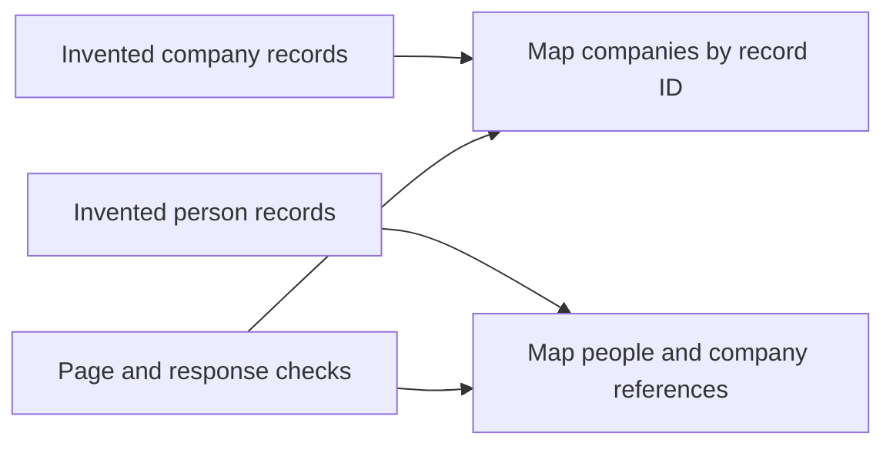

# Attio to Notion: companies and people

An offline TypeScript example of the companies-and-people mapping from a Notion Worker that synced an Attio CRM into Notion. It uses invented records. It does not call Attio or Notion, and it does not show whether the original worker is still deployed.

## What the original worker did

The original registered two syncs, companies and people, both in replace mode. It queried Attio with `POST /v2/objects/{companies|people}/records/query` and a body of `{ limit, offset }`, waited on a pacer of 10 requests per 1000ms, and took pages of 500 records. A full page continued. A short page ended that sync. Companies ran before people.

Each upsert used the Attio record id as the key. A missing company name, or a person with both name parts missing, used that id as the title. A person linked to a company by the company record id. The original did not trim values, copied email addresses by position even when the first was blank, emitted every row when an id repeated, and stringified connection strength with `String(...)`. It threw on a non-OK response and included the raw body. There was no retry.

This folder does not include the original worker, its other syncs, or any production id.

## What this example does



The diagram is the offline example. It does not perform the original Attio or Notion calls.

The mapping and page size above are unchanged. This example also:

- Trims text, and treats a whitespace-only name as missing.
- Skips blank emails before choosing the first two. A non-blank automated address such as `noreply@` is still copied.
- Keeps the last change when one page repeats a record id, and counts the dropped earlier changes.
- Rejects a page limit below 1 or a negative offset.
- Leaves an object or non-finite connection strength blank instead of `"[object Object]"` or `"NaN"`.
- Reports HTTP and body errors with the status and object name, without the response body. A `data` row that is not an object is rejected the same way. A missing `record_id` throws `Attio record is missing record_id` and the message does not include the record.

## Fields

Company: Name, Attio ID, Domain, Description, LinkedIn, City, State, Employee Range, Logo URL.

Person: Name, Attio ID, First Name, Last Name, Email, Email (Other), Phone, Job Title, Company, Description, LinkedIn, Connection Strength, Birthday, City, State, Photo URL.

People read `linkedin` first and `linkedin_url` only when `linkedin` is empty. The test records use reserved example domains, including `example.com` URLs in the LinkedIn fields, so the tests do not point at real profile pages.

## Run the checks

```sh
npm ci
npm test
```

`npm test` typechecks, compiles to `dist/`, and runs the tests with Node’s test runner. No token or account is required. On November 10, 2026, with Node v24.15.0, that command passed 21 tests. Passing it does not mean the original worker is connected or working now.

`npm run check` typechecks without writing `dist/`.

## Scope

Code to inspect and test, not a live sync. There is no fetch, credential configuration, retry, or production worker in this example. The original and the example are intentionally distinct.

## License

[MIT](LICENSE).
